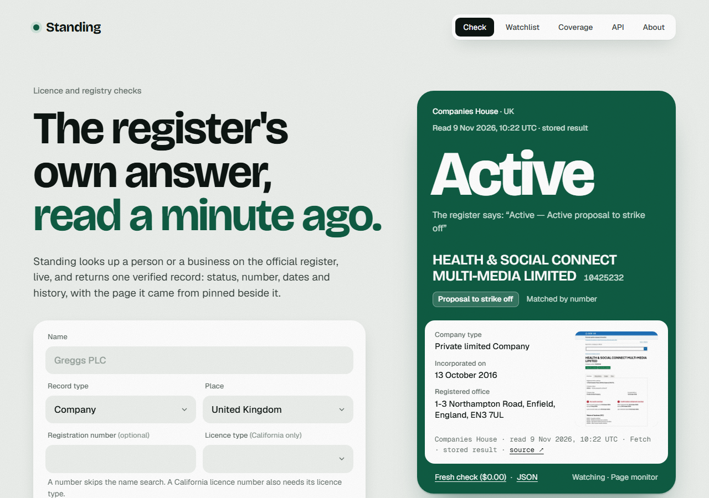

# Standing



Standing answers one question: what does the official register say about this person or business, right now? It looks the record up on the register itself, gives one status word from a fixed set, and keeps the proof beside it: the register's own wording, a screenshot of the page, the source link and the time it was read. When a name fits more than one record it lists them and gives no status until one is chosen. A record can be watched, and a change on the register then becomes an event with before and after. It was built for the TinyFish TinyVerify bounty and runs from one Cloudflare Worker with D1 and R2.

## Live

https://standing.hamdanesmail12-7a9.workers.dev

Five clicks show the whole product:

1. [The home](https://standing.hamdanesmail12-7a9.workers.dev/): the check form, a real watched record, and the bounty's requirements with where each can be seen working.
2. [A match](https://standing.hamdanesmail12-7a9.workers.dev/checks/223cbd5c-8a9b-4ff3-8b9a-08a80af6f1ed): a UK company, active with a proposal to strike off, and [its one-page receipt](https://standing.hamdanesmail12-7a9.workers.dev/checks/223cbd5c-8a9b-4ff3-8b9a-08a80af6f1ed/receipt).
3. [Ambiguous](https://standing.hamdanesmail12-7a9.workers.dev/checks/4035cd06-4444-47eb-ab0e-92b696a51bcf): "Greggs" fits 20 companies, so there is no status, only the list to choose from.
4. [No match](https://standing.hamdanesmail12-7a9.workers.dev/checks/a9f10ec4-6281-4d2a-a225-fc1bd5b6e4f8): a name that is on no register, with what was tried.
5. [The watchlist](https://standing.hamdanesmail12-7a9.workers.dev/watchlist): four records watched by TinyFish Monitor, chosen because each may change this week.

Live figures are at [/api/stats](https://standing.hamdanesmail12-7a9.workers.dev/api/stats). On 10 Nov 2026 at 07:52 UTC it read: 38 checks run, 11 records, 4 watched, 6 Monitors active, $1.90 of TinyFish spend.

## What it answers

A status is given only when exactly one record matches. It is one of nine words: Active, Conditions, Suspended, Removed, Not licensed, Expired, Dissolved, Insolvency, Unknown. The register's own wording always stays beside it, so "Active" for a company with a strike-off proposed still shows "Active proposal to strike off".

Everything else is said plainly and is never dressed up as a status:

- **Ambiguous.** A name matches only when it is the same name: the same given name and surname, middle names in the same order, no initials stretched into names. Two records that pass, or one that almost passes, give a list of candidates and how to choose.
- **No match.** With the spellings that were tried and what to try next.
- **Not supported.** The register is not covered, and Coverage says why.
- **Blocked.** The register showed a robot check. Standing reports that and does not go around it.
- **Check failed.** The read did not finish. Nothing is guessed from a half-read page.
- **Register down.** When a register cannot be read and Standing holds an earlier result for the same question, it shows that result, marked as stored with its real read time, and says that the live read just failed.

A status is never taken from a line in a search result. It is read from the record's own page.

## Coverage

| Register | Place | Records | How it is looked up | How it is watched |
|---|---|---|---|---|
| General Medical Council | UK | doctors | Agent by name, Fetch by number | Page monitor |
| Nursing and Midwifery Council | UK | nurses, midwives, nursing associates | Agent | Topic monitor and the shared hearings page |
| Solicitors Regulation Authority | UK | solicitors | Agent | Topic monitor and the shared decisions page |
| Companies House | UK | companies | Fetch | Page monitor |
| CA Department of Consumer Affairs | California, US | licensed professionals | Agent by name, Fetch by number | Page monitor |
| Florida Division of Corporations (Sunbiz) | Florida, US | companies | Fetch, by name | Page monitor |

The same table, with each register's notes and last successful read, is at [/api/registries](https://standing.hamdanesmail12-7a9.workers.dev/api/registries).

**The reader check.** Once a UTC day Standing reads one known business record on each register it reads with Fetch (GREGGS PLC on Companies House, SANTA FE FAMILY PHARMACY on the California DCA, PUBLIX ASSET MANAGEMENT COMPANY on Sunbiz) and checks that its own reader still finds the record's number, its name and a status. A register can change its pages without notice, and this is how Standing finds out before a lookup does. The result is beside each register on the [Coverage page](https://standing.hamdanesmail12-7a9.workers.dev/coverage) and in `reader_checks` at `/api/stats`. It is a check on Standing, not on anyone: it never reads again a record someone looked up or watches, and it keeps nothing as a record. GMC is not in it, because its pages are doctors' own records and Standing does not choose a person to read. NMC and SRA are not in it either: they are read only by the Agent, which costs money for each read.

Registers that were tried and cannot be read are listed too, each with the reason seen: the UK FCA register, the New York Office of Professions, New York DOS corporations, Dubai DHA Sheryan, the California Contractors State License Board and the Medical Council of New Zealand. The [Coverage page](https://standing.hamdanesmail12-7a9.workers.dev/coverage) has the reasons.

## How TinyFish is used

| Service | What it does in Standing | Where in the code | How to see it working |
|---|---|---|---|
| Agent | Searches the registers that have no search address (GMC, NMC, SRA, and California by name) in a real browser, with an output schema. It opens a record only when exactly one row matches. One run at a time, 12 steps at most. | `src/registries/`, `src/checks/queue.ts`, `src/checks/resolve.ts` | A check with `"method": "agent"` |
| Fetch | Reads search pages and record pages as text: Companies House, Florida, and GMC and California record pages by number. It also re-reads a watched page when its Monitor reports a change. | `src/tinyfish/fetch.ts`, `src/checks/record.ts`, `src/monitoring/hook.ts` | A check with `"method": "fetch"` |
| Browser | Takes the full-page screenshot kept as evidence, declining a plain cookie banner first. | `src/tinyfish/browser.ts`, `src/checks/evidence.ts` | `evidence_screenshot_url` on any match |
| Monitor | Page monitors on watched record pages, Topic monitors on watched names, and two shared monitors on regulators' decision pages. A Monitor run is the only thing that triggers a re-check. | `src/monitoring/`, `src/tinyfish/monitor.ts` | [/api/events](https://standing.hamdanesmail12-7a9.workers.dev/api/events) and the watchlist |

Each one does a job nothing else here does. Without Agent three of the six registers could not be searched by name. Without Fetch no record page would be read. Without Browser no result would carry its screenshot. Without Monitor nothing would ever be re-checked, because no scheduled job in Standing reads a register.

Calls and spend per service come from Standing's own ledger, one row per TinyFish call, shown on the [About page](https://standing.hamdanesmail12-7a9.workers.dev/about) and in `tinyfish_calls` at `/api/stats`.

TinyFish Search was used once, outside the Worker, by `scripts/curate-watches.mjs` to find the public notices behind the four curated watches. It is not part of the running product and its calls are not in the ledger.

## API, briefly

```bash
curl -s -X POST https://standing.hamdanesmail12-7a9.workers.dev/api/checks \
  -H 'content-type: application/json' \
  -d '{"query":"Greggs PLC","record_type":"company","jurisdiction":"GB"}'
```

The answer carries a `check_id`. `GET /api/checks/<check_id>` returns one record shape for every register:

```json
{ "outcome": "match", "status": "active", "status_raw": "Active — Active proposal to strike off",
  "flags": ["proposal_to_strike_off"], "full_name": "…", "licence_number": "10425232",
  "registry": "companies-house", "source_url": "https://find-and-update.company-information.service.gov.uk/company/10425232",
  "evidence_screenshot_url": "…", "checked_at": "2026-11-09T10:22:38.298Z", "cached": false, "method": "fetch" }
```

An ambiguous answer has no `status` at all, only `candidates`, `candidates_total` and `how_to_resolve`. A no-match has `variants_tried` and `suggestions`.

Other routes: `GET /api/registries`, `GET /api/records/:id`, `GET /api/records/:id/history`, `POST` and `DELETE /api/records/:id/watch`, `GET /api/events`, `GET /api/export.json`, `GET /api/stats`. The [API page](https://standing.hamdanesmail12-7a9.workers.dev/api) documents each.

## Run it locally

Needs Node 24 or later.

```bash
npm install
cp .dev.vars.example .dev.vars    # then fill in the three values
npm run migrate:local
npm run dev
```

```bash
npm test          # no network: every TinyFish call is mocked
npm run check     # typecheck, tests and wrangler deploy --dry-run (what CI runs)
```

Tests never call TinyFish. The opt-in live tests in `tests/integration/` run only with `STANDING_LIVE=1` and cost at most $0.21 each. To deploy a copy of your own, follow [docs/runbook.md](docs/runbook.md).

## How it was built and verified

**Design first.** The design is in [docs/specs/2026-11-03-standing-design.md](docs/specs/2026-11-03-standing-design.md) and the plans are in [docs/plans/](docs/plans/). What changed while building, why, and every live TinyFish call with its cost, is in [docs/build-log.md](docs/build-log.md). The look is set in [DESIGN.md](DESIGN.md).

**Tests.** On 14 Nov 2026 the suite has 665 tests: 658 pass and 7 are skipped, the opt-in live ones. `npm run check` runs in GitHub Actions on every push ([.github/workflows/check.yml](.github/workflows/check.yml)).

**Found live, then fixed.** Reading real registers turned up cases no fixture had. A search that never ran used to read as "no match" and now reads as a failed check. A register that returns its nearest names for a name that does not exist used to read as ambiguous and now reads as no match. Companies House's "Active — Active proposal to strike off" is kept as Active with a flag, not flattened. Each is in the build log with the check that showed it.

**The curated watches.** The four watched records were chosen from public notices on 9 Nov 2026 because each may change before the bounty closes: three companies with a winding-up order in The Gazette, and one nurse with a hearing listed for 11 Nov 2026. [docs/curated-watches.md](docs/curated-watches.md) lists each with its source. People are shown by record type and number on overview pages.

## Limits and posture

- Standing reads only public registers, one record at a time, the way a person would. There is no bulk endpoint, and no scheduled job reads a register.
- Public use is capped: 25 checks per visitor a day, 8 checks a day across all visitors that need a live Agent search, and 4 public watch slots kept 7 days each. All paid work pauses at $4 of total spend. A capped or paused request gets a plain reason.
- A public lookup nobody watches is deleted, with its screenshot, after 24 hours. Visitors are known only by a salted hash of their IP address.
- It uses the standard browser only. A robot check or CAPTCHA ends the check as "blocked".
- Result and record pages are marked noindex.
- No real person is named in the code, the tests or the docs. The test data was recorded from the public registers and then edited: every person in it has an invented surname and an invented registration number. Registered businesses keep their names, and the people I chose to watch on the live site appear by registration number only.

## Licence

MIT.
